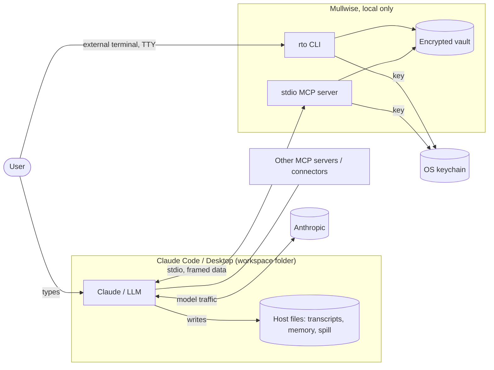

# Threat model

**Status: Skeleton (P0). Not v1.**

This file seeds the threat model. It names the assets, actors and threats the
design already knows about, and marks the rest as open. v1 is written at the P1a
**first-real-data gate**. No real thoughts go into Mullwise before then.

Sources: [`design-plan.json`](../architecture/design-plan.json) (`plan.securityPlan`,
`plan.risks`), [`roadmap.md`](../architecture/roadmap.md) (its Decisions table wins
over the design plan) and [`SECURITY.md`](../../SECURITY.md).

ADRs are cited as `ADR-000N`. They are not on `main` yet, so they are not linked.

## 1. Scope and assumptions

- v1 is local. The MCP server is stdio only, has no network listener and makes no
  outbound calls.
- One user, one PC, one vault. Multi-user is P3.
- **Out of scope:** malware running as the same OS user. It can read the keychain,
  the vault and the process memory, and v1 does not try to stop it.
- **There is no disk encryption on this PC** (Windows Home, no Device Encryption).
  Vault encryption does not rely on it. Copies of text outside the vault are a
  residual risk (section 6).
- Key custody is the **OS keychain via `@napi-rs/keyring`, plus an offline recovery
  code** (roadmap Decisions, `ADR-0002` as amended).
- Claude, running on the user's own subscription, makes every judgement. Text the
  user types into Claude is processed under their Claude account's terms.

## 2. Assets

| Asset | Where it lives | Why it matters |
|---|---|---|
| Vault records | Sealed event log in `node:sqlite`, outside OneDrive and git. Each record is AES-256-GCM with AAD and padding. | The user's private thoughts. Often about real people, money, health or work. |
| Data key (DEK) | In memory while the server or CLI runs. Stored only wrapped. | Decrypts every record. |
| Keychain key | OS credential store, via `@napi-rs/keyring`. | Unwraps the DEK without a prompt. |
| Recovery code | Offline, held by the user. A 130-bit code through HKDF-SHA256. | Only way back in if the keychain entry is lost. |
| Backups | Destination and cadence not yet decided (roadmap, deferred question 1). | A copy of the vault, so it needs the same protection. |
| Host traces | Claude Code transcripts, Desktop sessions, auto memory, tool-result spill files, Terminal panel, shell history. | Plaintext copies of thoughts outside the vault. |

## 3. Actors and trust boundaries

| Actor | Trust |
|---|---|
| User | Trusted. Holds the recovery code. Does admin work in an external terminal. |
| Claude / the LLM | Semi-trusted. Makes judgements, can be steered by text it reads. Never trusted with admin actions. |
| stdio MCP server | Trusted code. Validates, frames output as data and enforces guards. |
| `rto` CLI | Trusted code. Human-only admin work (init, backup, verify, recover), gated on a TTY. |
| OS keychain | Trusted to hold the keychain key for the current user. |
| Claude Code host files | Untrusted store of plaintext copies. Written by the host, not by Mullwise. |
| Other MCP servers and connectors | Untrusted. They may be active in the same session. |
| Anthropic | Processes what Claude sees, under the user's account terms. Retention is theirs. |

Trust boundaries:

1. User and LLM to Mullwise: stdio only. Nothing else listens.
2. LLM to other servers: shared session, so another server's output and tools
   can reach the same model.
3. Mullwise to the host: the host writes plaintext copies Mullwise cannot control.
4. Mullwise to the keychain: same-user only.
5. Host to Anthropic: outside Mullwise's control.

## 4. Seeded threats

Rows the design plan already names are filled. Others are marked **To be completed
at v1**. Mitigation IDs refer to section 5.

### 4.1 STRIDE

| Category | Threat | Mitigation |
|---|---|---|
| Spoofing | Plugin or another server active in the wrong context (the "lethal trifecta" of private data, untrusted input and an outbound channel). | M3 |
| Spoofing | Stale server writes during restore, rekey or forget. | M4 |
| Tampering | Prompt injection via stored text steers Claude into harmful tool calls. | M1 |
| Tampering | Dependency or build compromise (supply chain). | M6 |
| Repudiation | To be completed at v1. | |
| Information disclosure | Plaintext copies in host traces (transcripts, memory, spill, Terminal panel, history). | M5 |
| Information disclosure | Key held only in the keychain is read by other software. Same-user malware is out of scope. | M7 |
| Denial of service | Key loss makes the vault unreadable. | M7 |
| Denial of service | Other DoS causes (corruption, lock contention). | To be completed at v1 |
| Elevation of privilege | Excessive agency: Claude bulk-edits or bulk-marks records. | M2 |
| Elevation of privilege | Claude reaches Bash, PowerShell or a terminal tool and reads the vault or key. | M3, M5 |

### 4.2 LINDDUN

| Category | Threat | Mitigation |
|---|---|---|
| Linking | Cross-references link records about the same person. Link noise is also a quality risk. | To be completed at v1 |
| Identifying | Real-name data in eval fixtures could re-identify someone. | M6 |
| Non-repudiation | To be completed at v1. | |
| Detecting | Record sizes or counts leak through file size or scheduled-run output. | To be completed at v1 (AAD and padding exist, `ADR-0001`) |
| Data disclosure | Same host-trace and Anthropic-retention exposure as STRIDE. | M5 |
| Unawareness | The user does not know what is retained and where. | M5 (`status` warning, docs) |
| Non-compliance | To be completed at v1. | |

## 5. Mitigations

| ID | Mitigation | Owner |
|---|---|---|
| M1 | Prompt injection: text-only framed results (`<rto:data>`), sanitizer, possible-instructions flag, URLs as code spans, static tool descriptions, red team. | `ADR-0003` |
| M2 | Excessive agency: permission tiers (allow, ask, `requiresUserInteraction`), budgets, the mark cap, the edit anti-bulk guard, undo. | `ADR-0004` |
| M3 | Workspace isolation: plugin `defaultEnabled` false, project-scope install, workspace lock on `CLAUDE_PROJECT_DIR`, `deniedMcpServers`, permission denies, auto and bypass modes off. | `ADR-0005`, `ADR-0009` |
| M4 | Epoch and key-ID re-check on every append, transactional restore, epoch-checked maintenance. | `ADR-0001` |
| M5 | Admin boundary and host hygiene: TTY gating, external terminal, deny of Bash, PowerShell and terminal tools, short transcript retention, auto memory off, `status` warning. | `ADR-0009` |
| M6 | Supply chain and repo: hardened pnpm, SHA-pinned actions, OSV, CodeQL, `ci-ok`, gitleaks, no user data in the repo, synthetic fixtures. | `ADR-0007`, [`CONTRIBUTING.md`](../../CONTRIBUTING.md) |
| M7 | Key custody: keychain key plus offline recovery code, locked mode when no key is available, monthly verify prompt, restore test. | `ADR-0002` |
| M8 | Zero network in v1: import and global bans plus a net-guard preload on both OSes. The Node permission model is not relied on. | `ADR-0001`, `ADR-0003` |

## 6. Residual risks

- Same-user malware can read the keychain key and the vault.
- Host traces persist outside the vault: transcripts, Desktop sessions of any age,
  scheduled-run sessions, auto memory, tool-result spill files, the Terminal panel,
  shell history and Remote Control transcripts.
- Anthropic retains what Claude sees, under the user's account terms.
- Without disk encryption on this PC, anything outside the vault is readable from
  the disk.
- Losing both the keychain entry and the recovery code loses the vault.
- A stored note can still try to steer Claude. Framing lowers the risk and does
  not remove it.

Details and the purge checklist: `docs/security/host-hygiene.md` (not yet on
`main`).

## 7. Pending spike items

Spike S1 (hello plugin in the terminal and the Code tab) has not run. These items
change the model and stay open until it does.

| Item | Why it matters | Status |
|---|---|---|
| Text-only result reaches the model | `M1` assumes framed text is the only channel. | **Pending S1** |
| `requiresUserInteraction` prompts in the Code tab | `M2` relies on it for `decide_suggestion`. | **Pending S1** |
| Read deny rule on the vault path matches | `M3` and `M5` assume it blocks Claude reading the vault. | **Pending S1** |
| `defaultEnabled` false plus project `enabledPlugins` | `M3` assumes the plugin loads only in the workspace. | **Pending S1** |
| Exact env the server receives, and whether the workspace lock variable reaches it | `M3` and the vault directory depend on it. | **Pending S1** |
| Whether explicit allow rules suppress prompts | Decides which tools run without a prompt (`M2`). | **Pending S1** |

## 8. Revision policy

| When | Action |
|---|---|
| P0 | This skeleton. |
| P1a, first-real-data gate | Write v1. Fill every **To be completed at v1** row and resolve every **Pending S1** item. |
| Every phase | Re-run the model and record changes. |
| Before P2b | Full rewrite, plus a [`SECURITY.md`](../../SECURITY.md) revision. P2b is the first internet-facing phase. |
